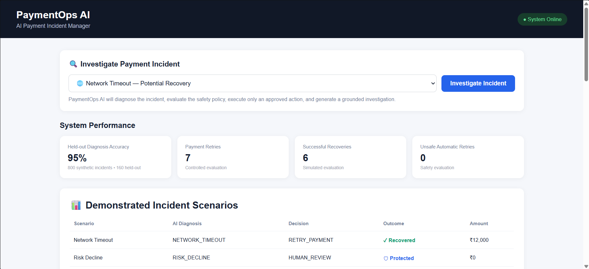
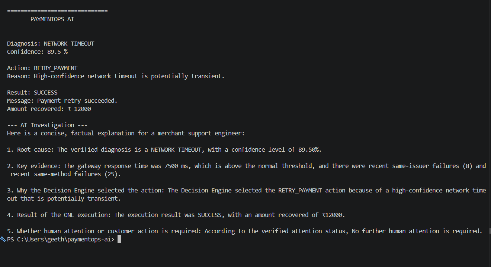

# PaymentOps AI

### AI-Powered Payment Incident Investigation & Safe Revenue Recovery

PaymentOps AI is an AI-assisted payment operations system that investigates failed payment incidents, diagnoses their likely root cause, determines whether recovery is safe, executes only bounded actions, and records every decision in an audit trail.

---

## 🚀 Problem

Payment failures can happen because of:

- Network timeouts
- Gateway errors
- Issuer declines
- Risk declines
- Invalid or expired cards
- Insufficient funds
- Webhook delivery failures

A failed payment does not always mean the same thing.

Blindly retrying every failed payment can create unnecessary retries, increase customer friction, and create operational risk.

PaymentOps AI provides a safer approach:

**Investigate → Diagnose → Decide → Guard → Act → Audit**

---

## 💡 Solution

PaymentOps AI combines:

1. Machine Learning for structured incident diagnosis
2. A deterministic Decision Engine for safe actions
3. Bounded action execution
4. Local LLM-based investigation and explanation
5. An audit trail for every decision
6. Held-out evaluation on synthetic payment incidents

The LLM does not override the ML diagnosis or safety policy.

---

## 🏗️ Architecture

```text
                    Merchant / Support Engineer
                              |
                              v
                       Flask Dashboard
                              |
                              v
                    PaymentOps Orchestrator
                              |
              +---------------+---------------+
              |               |               |
              v               v               v
        ML Diagnosis     Incident Data    Policy Rules
        Random Forest                       / Guard
              |               |               |
              +---------------+---------------+
                              |
                              v
                       Decision Engine
                              |
                +-------------+-------------+
                |             |             |
                v             v             v
          Retry Payment   No Retry      Human Review
                |
                v
         Action Executor
                |
                v
           Recovery Result
                |
                v
            Audit Trail
                |
                v
       Ollama Investigation

/ Explanation

## 🤖 AI Components

### 1. ML Diagnosis

A Random Forest classifier diagnoses payment incidents using structured payment and operational signals.

The model uses features such as:

Payment method
Issuer
Gateway response
Gateway response time
Retry count
Webhook status
Recent issuer failures
Recent method failures
Failure rate
Card validity
Card expiry
Available balance
Risk score
Customer attempts

### 2. Decision Engine

The Decision Engine converts the diagnosis and confidence into an approved action.

Examples:

Diagnosis	Action
NETWORK_TIMEOUT	RETRY_PAYMENT
GATEWAY_ERROR	RETRY_PAYMENT
WEBHOOK_FAILURE	RETRY_WEBHOOK
INSUFFICIENT_FUNDS	NO_RETRY
INVALID_CARD	CUSTOMER_CORRECTION
EXPIRED_CARD	CUSTOMER_CORRECTION
RISK_DECLINE	ESCALATE / HUMAN_REVIEW
ISSUER_DECLINE	ESCALATE

### 3. Safety Controls

Automatic actions are bounded by explicit rules.

Confidence threshold: 85%
Maximum automatic payment retries: 2
Low-confidence diagnosis → Human Review
Risk-related declines are not automatically retried
Insufficient-funds failures are not automatically retried
Retry limit → Human Review
Unknown situations → Human Review

The LLM cannot override these controls.

### 4. AI Investigation

Ollama with Llama 3.2 is used to generate a concise investigation from verified incident evidence.

The investigation explains:

Root cause
Supporting evidence
Why the action was selected
Execution result
Whether human attention is required

The LLM is instructed not to invent missing information or change the approved action.

### 📊 Evaluation

The model was evaluated on a held-out test set created from 800 synthetic payment incidents.

Diagnosis Performance

95% held-out test accuracy

The evaluation used:

800 synthetic incidents
20% held-out test split
160 held-out incidents
Stratified train/test split
Random Forest classifier
Agent Evaluation

The controlled evaluation produced:

Metric	Result
Held-out incidents	160
Diagnosis accuracy	95.00%
Payment retries	7
Successful simulated recoveries	6
Retry success rate	85.71%
Simulated amount recovered	₹100,492
Unsafe automatic retries	0

Important: Recovery amounts are simulated evaluation results using synthetic incidents. They do not represent real merchant money or real Razorpay transaction data.

🛡️ Safety Demonstrations

PaymentOps AI demonstrates four important behaviors.

Network Timeout
NETWORK_TIMEOUT
        ↓
89.5% confidence
        ↓
RETRY_PAYMENT
        ↓
Successful simulated recovery
Risk Decline
RISK_DECLINE
        ↓
HUMAN_REVIEW
        ↓
No automatic retry
Insufficient Funds
INSUFFICIENT_FUNDS
        ↓
NO_RETRY
        ↓
Retry intentionally avoided
Retry Limit
NETWORK_TIMEOUT
        ↓
Retry limit reached
        ↓
HUMAN_REVIEW
        ↓
No further automatic action

📋 Audit Trail

Every processed incident can be recorded with:

Transaction ID
Diagnosis
Model confidence
Selected action
Decision reason
Execution result
Amount recovered
Timestamp

This provides traceability from:

Evidence → Diagnosis → Decision → Action → Result

🖥️ Dashboard

The Flask dashboard provides:

Incident investigation
AI diagnosis
Model confidence
Incident evidence
Decision Engine output
Recovery result
AI investigation
System performance metrics
Demonstrated scenarios
Audit Trail

## Screenshots

### Web Dashboard
 

### Incident Investigation (CLI)
 

🧰 Tech Stack
Python
Flask
Scikit-learn
Random Forest
Pandas
Joblib
Ollama
Llama 3.2
HTML
CSS
JavaScript    